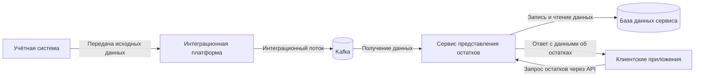

# Архитектура: логический контекст

Схема показывает участников и основные направления взаимодействия на уровне контекста. Это упрощённая C4-подобная схема, а не полный deployment- или component-level дизайн.

## Как читать схему

- **Учётная система** — исходный источник данных.
- **Интеграционная платформа** — промежуточный слой для передачи данных.
- **Kafka** — брокер сообщений в интеграционном потоке.
- **Сервис представления остатков** — предоставляет данные клиентам через API.
- **База данных сервиса** — хранит данные, поступившие через интеграционный процесс.
- **Клиентские приложения** — потребители API.

## Границы достоверности

Схема отражает подтверждённые на уровне кейса роли компонентов и общий поток данных. Конкретные топики, форматы сообщений, схема хранения, механизм повторной обработки и инфраструктурное размещение намеренно не указаны.
