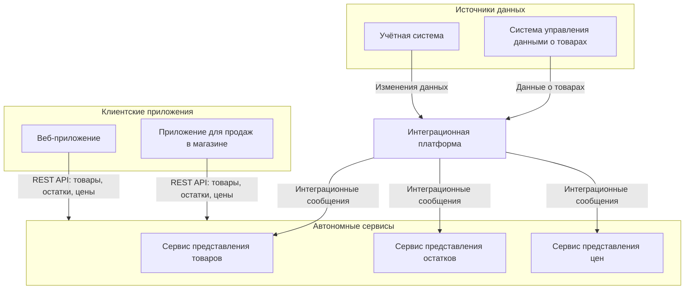
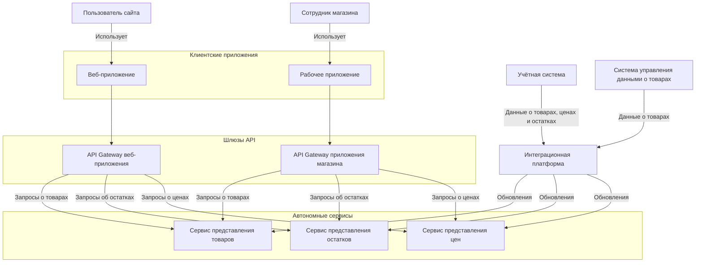

# Архитектура сервиса представления остатков

Ниже две схемы: контекст показывает место сервиса в продуктовой экосистеме, контейнерная схема — основные приложения и сервисы, через которые проходят запросы. Названия систем, сервисов и клиентов обезличены.

## 1. Контекстная диаграмма

Сервис остатков — часть группы автономных сервисов, которая предоставляет клиентским приложениям данные о товарах, ценах и остатках. Клиенты получают данные через REST API, а сервисы наполняются данными из учётных систем через интеграционную платформу.

## 2. Контейнерная диаграмма

В клиентском пути запрос проходит от пользовательского приложения через API Gateway к нужному сервису. Сервисы представления товаров, остатков и цен разделяют ответственность за разные типы данных. Обновления поступают из учётных систем через интеграционный поток.

## Что важно в этом решении

- Клиентские приложения обращаются к API автономных сервисов, а не напрямую к учётной системе.
- Сервисы разделены по предметным данным: товары, остатки и цены.
- Интеграционный поток обновляет данные отдельно от клиентских запросов.
- В этом кейсе фокус — сервис представления остатков: его API, бизнес-правила и интеграция данных.

## Границы схем

Схемы передают логическую структуру по исходным архитектурным диаграммам. Они не описывают внутреннее устройство API Gateway, физическое размещение, конкретные топики и форматы сообщений. Названия систем и клиентов заменены обобщёнными; фактические связи и протоколы следует уточнить перед публикацией деталей реализации.
