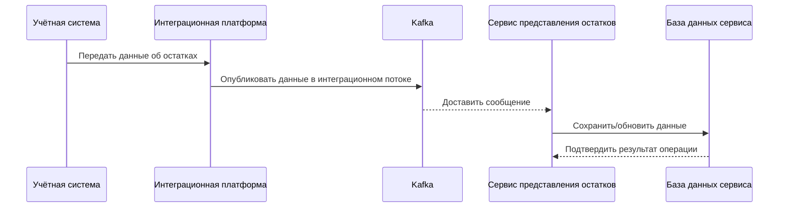
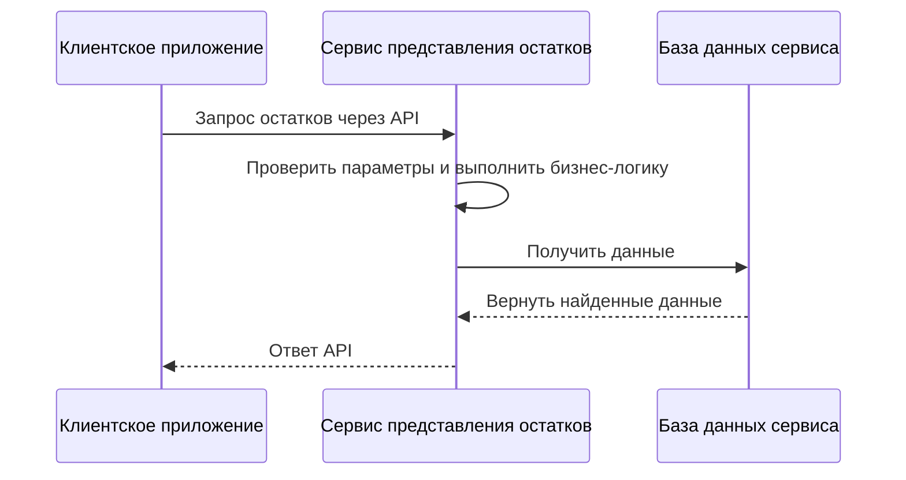

# Диаграмма последовательности

Диаграмма показывает два логических процесса отдельно: обновление данных и чтение остатков клиентским приложением. Она не задаёт периодичность обновления, гарантии доставки или точную реализацию интеграционного потребителя.

## 1. Обновление данных

## 2. Получение остатков

## Примечания

- Это логическая последовательность, а не спецификация протоколов.
- Не показаны не подтверждённые детали: конкретные коды ответа, повторы, дедупликация, DLQ и транзакционные границы.
- Ошибочные и альтернативные сценарии следует добавлять после сверки с фактическими требованиями и реализацией.
